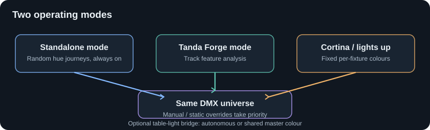
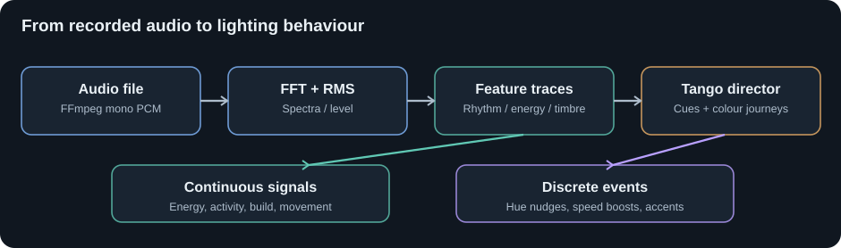
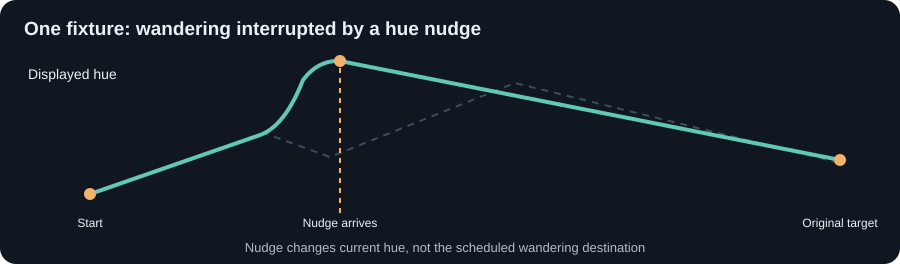
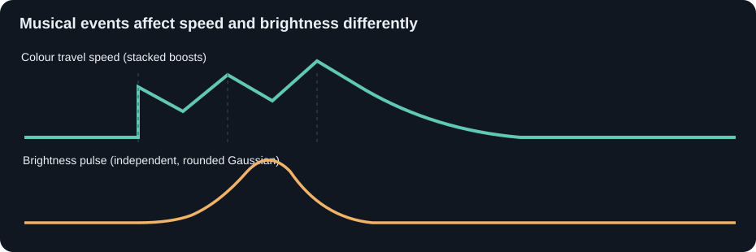
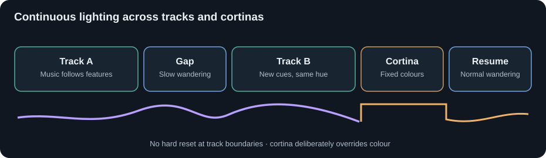
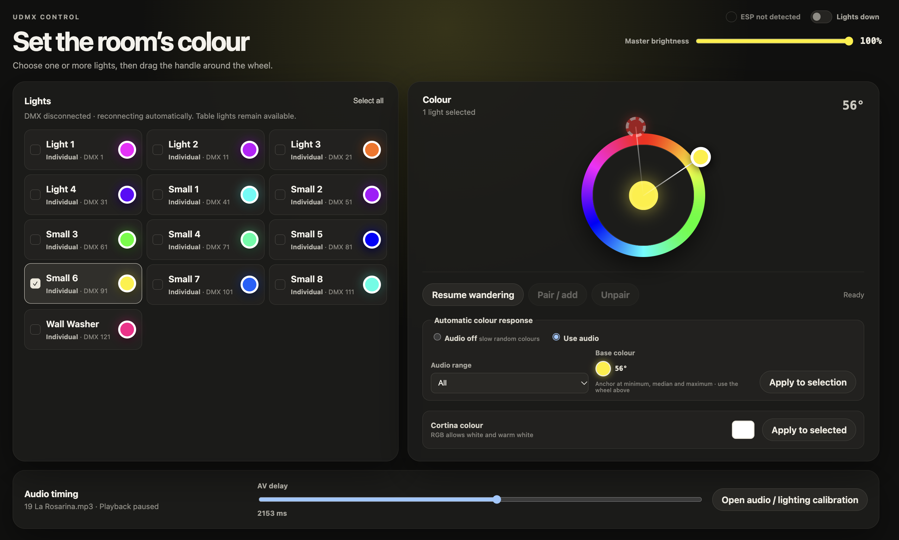
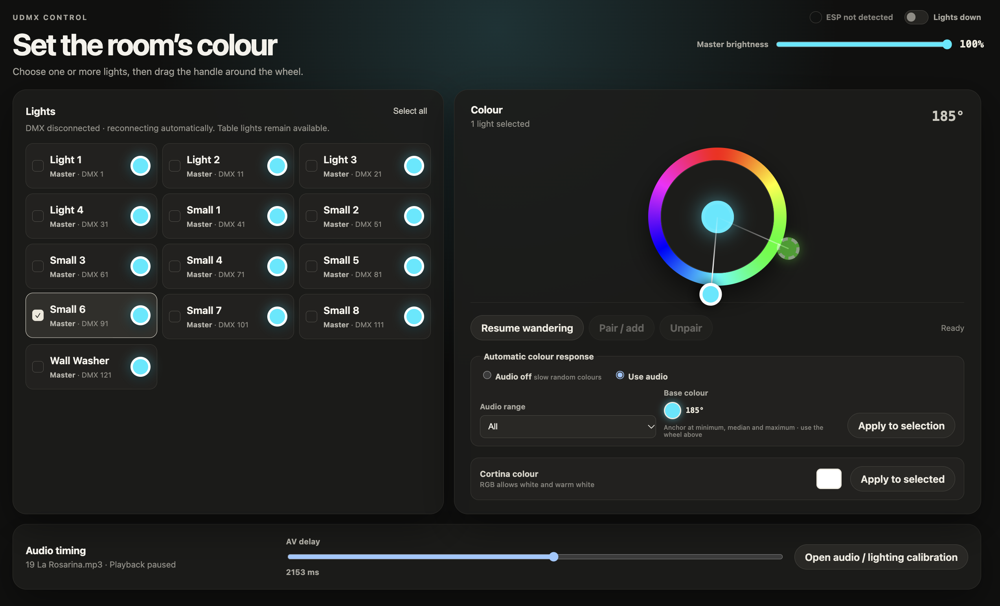
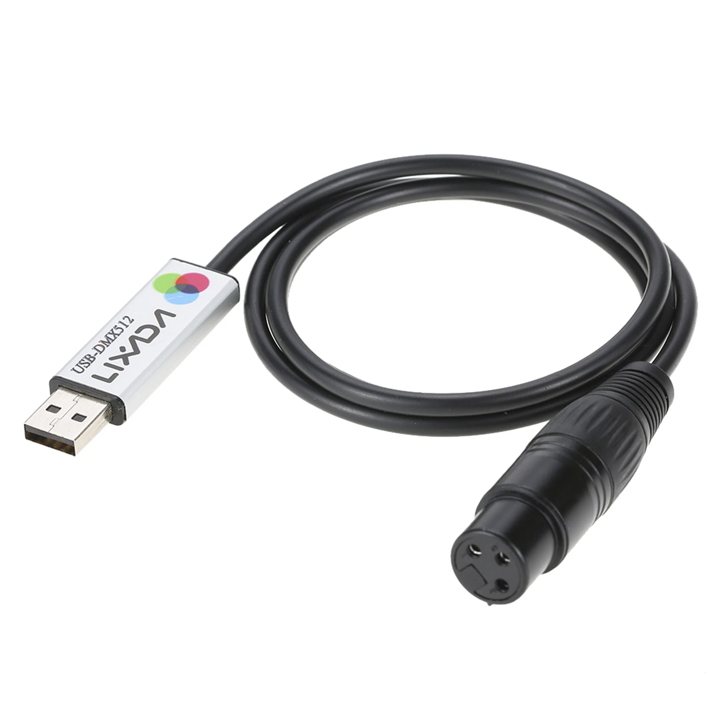
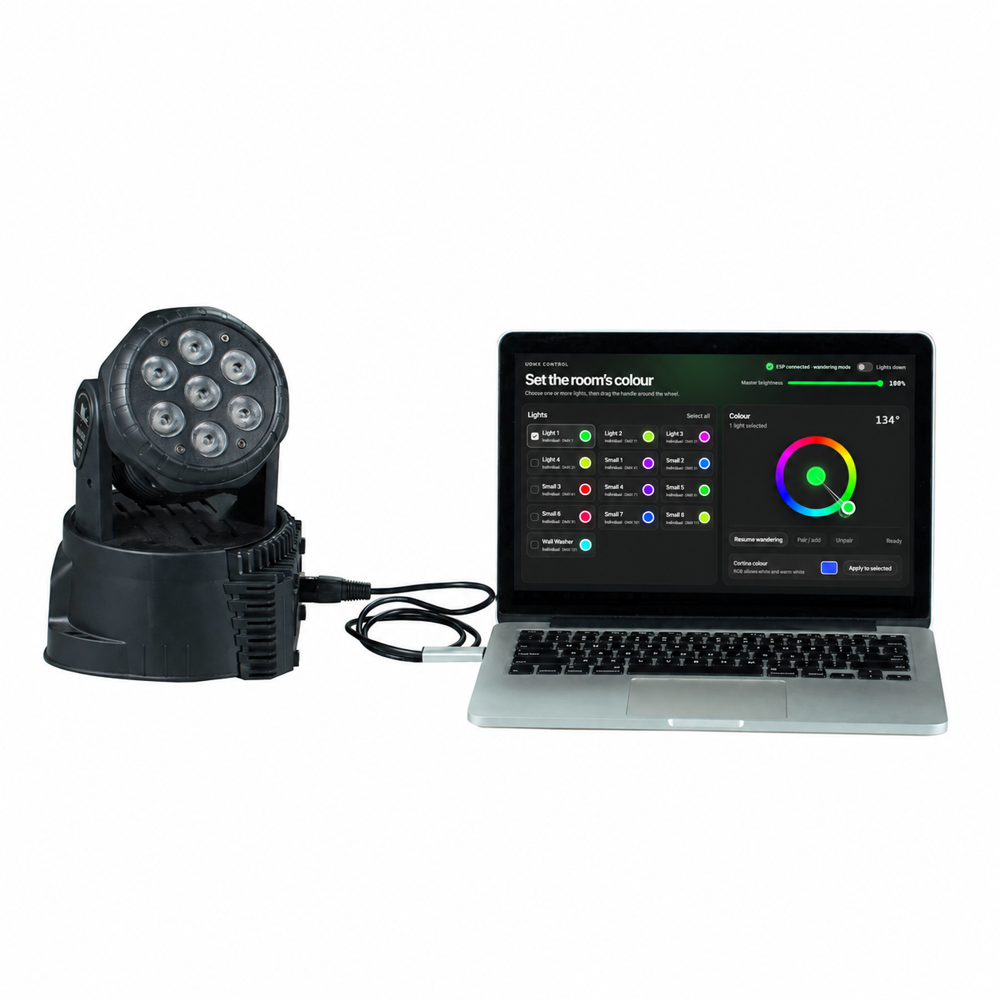

# Lighting controller

Lighting is a **dual-mode Node.js lighting application for one DMX universe**.
It works independently as an ambient lighting controller, or as a companion to
**Tanda Forge** on the same computer. Rather than a prescriptive beat-synchronised
light show, it loosely reflects the music's intensity and changes in character
by modifying smooth colour transitions. A browser page controls the fixtures
manually, and an optional bridge coordinates ESP table lights. Tanda Forge also
notifies Lighting when a cortina plays, allowing the room to adopt selected
cortina colours to support **cabeceo** (making eye contact to invite a dance).

The controller can send the same DMX universe to one or both supported USB
adapter types:

- **Anyma/uDMX-compatible adapter** using USB control transfers. The usual USB
  identity is `16c0:05dc`.
- **FTDI Open DMX adapter** using a 250000-baud serial DMX stream. Select this by
  serial number where possible, or by device path.

When both adapters are connected, each frame is mirrored to both. If one output
disconnects, the controller continues on the other. Missing DMX outputs are retried every five seconds, including at startup. The
web controls and ESP bridge remain available while DMX is disconnected.

## Lighting behaviour

In normal operation every automatic fixture moves independently between random,
fully saturated hues. Transitions follow the shortest route around the colour
wheel and use the random duration range in `transitionSeconds`.

The optional virtual master periodically gathers the automatic fixtures onto a
shared hue and timing. It completes a random number of shared transitions and
then returns them to independent wandering. Configure this with `masterMode`.
Fixtures held at a static colour from the web page are not changed by normal or
master wandering. Entry uses a smooth random 2–5 second convergence onto the
shared hue. On exit, each fixture receives its own random destination and a
smooth 2–10 second departure; ordinary individual wandering begins only after
that departure completes. These ranges are configurable as
`masterMode.entryTransitionSeconds` and `masterMode.exitTransitionSeconds`.

## Two operating modes



### 1. Standalone ambient lighting

With Tanda Forge absent, unavailable, stopped or paused, each automatic DMX
fixture continues **wandering**: choose a target hue and a random duration, move
smoothly towards it, then choose another target and duration. This runs at a
restrained baseline speed even without music. Fixtures can be manually held at a
static hue, paired to follow a leader, or selected in groups; the normal colour
wheel and **Resume wandering** commands operate independently of Tanda Forge.

### 2. Music-responsive lighting with Tanda Forge

When Tanda Forge plays a normal track on its main output, it sends playback
snapshots to `POST /api/playback`. Lighting analyses the whole track once and
uses the current playback position to evaluate a **single tango director**.
It adjusts the ongoing wandering rather than replacing it with a beat-chasing
sequence. The director can accelerate colour travel during builds, briefly
increase travel speed around salient events, nudge hue at significant changes,
and introduce restrained, rounded brightness accents. There is no separate
legacy music renderer or special `--tango-director` startup flag.

The director avoids turning the final collapse into silence into a lighting
cue. When one song finishes, the **currently displayed hue is carried into
ordinary wandering**, and when another music profile becomes active it starts
from those displayed hues. There is no intentional colour reset at the track
boundary; transitions continue through a gap in playback. Static/manual
colours, lights-up/cortina, pairing and the global master brightness still take
priority over automatic music effects.

### How the analysis works (no trained model)

FFmpeg decodes a mono 11,025 Hz signal in a worker thread. A 2,048-point
windowed FFT is evaluated every 512 samples (about 46 ms). Noise-floor-adjusted
spectra supply spectral-flux onsets, lower-frequency energy, spectral
brightness and 12-bin chroma (pitch-class) features; short-time RMS supplies
energy. Smoothed differences over short and longer time windows produce
separate **rhythm, dynamics, harmony and timbre change** measurements.
Onset activity, locally contrasting attacks, an approximately five-second
energy **build** and combined **salience** are also measured. Feature traces
are sampled onto a 0.2-second grid for deterministic playback evaluation.



The features describe changes in the *recorded audio*, not identified notes,
singers, bars or formal musical phrases. The measurements are relative to the
recording and use heuristics; they are not reliable semantic music labels.
In particular, `harmony` is a chroma-change descriptor, not a chord
transcription, and `accent` is a locally prominent onset, not proof of a
musical downbeat. Historical noise and unusual recordings can affect results.

### How the director converts features to lighting

Each automatically controlled fixture has its own reproducible random hue
journey, with its own target and nominal 1–20 second travel duration in music
mode. The target is replaced upon arrival. Sustained build increases the
travel rate; detected salience, accent or colour-change events add **temporary
speed boosts**. Those boosts decay exponentially and add together if events
arrive close together, up to a configurable maximum.

A substantial rhythm, dynamics, harmony or timbre peak may also trigger a
**hue nudge**: over roughly 0.6 seconds the displayed colour moves by at least
the configured hue displacement, arriving at the event timestamp. The original
wandering target remains; after the nudge the fixture resumes travelling
towards that target, rather than choosing a replacement destination.



Brightness is a separate, relatively restrained effect. Prominent accents can
produce a half-second **Gaussian-shaped brightness pulse** during appropriate
musical passages. The pulse has its own offset (`tangoPulseDelayMs`, default
+200 ms) and does not change the global AV/DSP delay (`avDelayMs`). Activity
drops no longer produce dedicated pulses. The director also guards against
false cues from a terminal drop into silence; where an ending is ambiguous,
this remains a heuristic rather than a perfect music-boundary detector.



**Controls in the Music response panel** include music enable/disable, minimum
and maximum brightness, colour-change sensitivity, event sensitivity, minimum
hue displacement, event speed multiplier, speed-boost decay, maximum combined
speed, accent fallback delay, accent pulse delay and AV delay. Changes to
settings that affect precomputed trajectories rebuild the director data; they
do not require a fresh audio FFT analysis. The current venue `config.json` is
the source of initial values and settings can be changed through the web page.
Some existing configuration fields are retained for older installations; the
unified director is the active music algorithm.

### Track handoff and event priority



- **Normal track:** music-derived colour and speed interventions are applied to
  automatic fixtures, while static overrides remain untouched.
- **End / silence / pause:** no final-drop lighting event or colour reset;
  ordinary slow wandering resumes from the last visible colour.
- **Next track:** new director trajectories are phase-offset to start at each
  fixture's current displayed hue; brightness is blended over the handoff.
- **Cortina:** Tanda Forge sends the separate lights-up notification, which
  takes priority over wandering and music cues. Each DMX fixture fades to its
  saved `lightsUpColour` (which may be different for every light). This brighter,
  stable state is intended to help dancers see one another for cabeceo. On
  lights-down the underlying normal lighting behaviour resumes.

### Optional ESP table lights

The ESP bridge controls a separate table-light group. In its **autonomous**
mode the table lights do their own colour wandering. During a shared/master
period, the bridge can switch them to **MASTER** colour control, and the
Lighting application supplies a common hue target and transition duration.
The table lights do not receive DMX brightness pulses or independent
per-fixture music journeys. Their master/wander state is controlled by the
bridge and may switch as a group; see [ESP table-lights bridge](#esp-table-lights-bridge)
for the actual protocol and authority rules. Cortina lights-up notifications
are forwarded to the bridge as well.

### Individual and master modes

In individual wandering mode, each fixture chooses and follows its own colour
target:



In synchronised master mode, every automatic fixture follows the shared master
target and timing:



The separate **lights up** state temporarily overrides all normal and static
colours. Each fixture fades to its own `lightsUpColour`; **lights down** fades
back into the normal behaviour that has continued underneath. The global
`lightsUp.fadeUpSeconds` and `lightsUp.fadeDownSeconds` settings control these
two fade times.

## Installation and startup

Requirements:

- Node.js 18 or newer.
- A supported USB DMX adapter for DMX fixtures (optional for table-light control).
- A valid `config.json` with non-overlapping fixture addresses.

Install and start:

```sh
npm install
npm start
```

To use a different configuration file:

```sh
node lighting.js path/to/config.json
```

The terminal reports the detected DMX output or outputs, the web address, and
the ESP bridge status. Press Ctrl-C for an orderly shutdown: the application
sends a blackout frame and closes its USB and serial devices.

## Web control page

While Lighting is running, open:

```text
http://localhost:8080
```

The server listens on all network interfaces, so another device on the same
network can use `http://<lighting-computer-address>:8080`. Change `webPort` if
port 8080 is already occupied.

The page provides:

- **Lights up / Lights down** in the top-right corner. This fades the DMX
  fixtures and also sends the state to the ESP bridge when connected.
- **ESP status**, showing whether the table-lights bridge is detected and
  whether it is supplying master or wandering targets.
- **Fixture selection** and **Select all**.
- A **colour wheel**. Moving it holds the selected fixtures at a static hue.
- **Resume wandering**, which removes the static override from the selection.
- **Pair / add**, which makes selected fixtures follow one leader, and
  **Unpair**, which detaches selected members.
- **Cortina colour**, an RGB picker for the selected fixtures' lights-up colour.
  Press **Apply to selected** to apply it immediately and save it into the
  active configuration file. RGB permits pure white, warm white, or a calibrated
  colour for fixtures whose RGB white is unattractive.
- **Master brightness**, which affects every fixture in every mode. Fixtures
  with a brightness/dimmer channel receive this value directly; RGB-only
  fixtures have their RGB values scaled.

Cortina colour is applied to **every explicitly selected DMX fixture** (paired
or not), without changing its pairing or wandering settings. The picker keeps
the colour chosen by the operator while selection changes; it does not replace
that colour with the first selected fixture's stored setting. Mixed selections
that include the table-light bridge apply to the DMX fixtures only. The saved
cortina colours are displayed when lights-up/cortina mode is active; saving a
colour does not replace normal wandering colours.

## Fixture and channel configuration

DMX addresses and channel offsets are one-based. Define a reusable physical
layout under `fixtureTypes`, then assign that type and a start address to each
entry in `fixtures`.

The supplied configuration contains two example layouts:

| Fixture type | Footprint | Channel mapping used by Lighting |
| --- | ---: | --- |
| `4ch-rgbw` | 4 channels | Red, green, blue; channel 4 (white) held at 0 |
| `8ch-dimmer-rgbw` | 8 channels | Master brightness, red, green, blue; channels 5–8 held at 0 |

These names describe the included fixture profiles, not hard-coded limits. A
fixture type declares its entire `channelCount`, mapped `channels`, and any
`fixedChannels`. Supported mapped roles are `red`, `green`, `blue`, and optional
`brightness`. Unmapped channels are sent as zero. Fixed channels are useful for
mode, strobe, or unused white channels that must stay at a known value.

Example fixtures:

```json
{
  "fixtureTypes": {
    "4ch-rgbw": {
      "channelCount": 4,
      "channels": { "red": 1, "green": 2, "blue": 3 },
      "fixedChannels": { "4": 0 }
    },
    "8ch-dimmer-rgbw": {
      "channelCount": 8,
      "channels": { "brightness": 1, "red": 2, "green": 3, "blue": 4 },
      "fixedChannels": { "5": 0, "6": 0, "7": 0, "8": 0 }
    }
  },
  "fixtures": [
    {
      "id": "floor-1",
      "name": "Floor light",
      "address": 1,
      "type": "4ch-rgbw",
      "lightsUpColour": { "red": 255, "green": 220, "blue": 170 }
    },
    {
      "id": "washer-1",
      "name": "Wall washer",
      "address": 11,
      "type": "8ch-dimmer-rgbw",
      "lightsUpColour": { "red": 255, "green": 255, "blue": 255 }
    }
  ]
}
```

`lightsUpColour` defaults to full RGB white if omitted. Hue plus brightness is
not sufficient for this setting: the normal hue wheel is fully saturated, while
white requires the RGB channels to be mixed together.

Ensure fixture footprints do not overlap and do not extend beyond DMX channel
512. For example, an eight-channel fixture beginning at address 121 occupies
channels 121–128.

## USB DMX adapters

### Anyma/uDMX

Configure the USB vendor and product IDs:

```json
"usb": {
  "vendorId": "0x16c0",
  "productId": "0x05dc"
}
```

Lighting finds this device through USB rather than through a serial device path.
Transfers are retried briefly before the output is treated as disconnected.
Low-speed uDMX hardware can be unreliable behind cascaded bus-powered hubs; use
a direct port or powered hub when possible.

### FTDI Open DMX

Enable the Open DMX output and identify it by serial number (preferred):

```json
"openDmx": {
  "enabled": true,
  "serialNumber": "BG00QGXZ"
}
```

Alternatively specify its operating-system device `path`. A serial number is
more stable because device paths can change after reconnection or reboot.

On macOS, USB identities and serial numbers can be inspected with:

```sh
system_profiler SPUSBDataType
```

Only one application can own an adapter at a time. Stop QLC+, FreeStyler, or any
other DMX program before starting Lighting.

## ESP table-lights bridge

The ESP table-lights bridge sketch is included at
`table-lights/DMX-bridge/tango_light_3_DMX_bridge/tango_light_3_DMX_bridge.ino`. It connects over USB serial and can rebroadcast lighting state to
ESP-NOW-connected table lights.

Lighting scans for the configured USB vendor ID (normally `1a86`) and opens the
bridge at 115200 baud. No machine-specific serial path is built in. If the
operating system does not report a vendor ID, Lighting accepts one unambiguous
USB serial candidate; an explicit `path` is only an optional installation-level
override. Configure or disable the bridge under `externalMaster`:

```json
"externalMaster": {
  "enabled": true,
  "vendorId": "0x1a86",
  "baudRate": 115200,
  "scanSeconds": 5
}
```

The bridge and Lighting exchange newline-delimited messages:

- Lighting sends `1` plus a newline for lights up and `0` plus a newline for
  lights down. The bridge can rebroadcast that state to the table lights.
- Lighting accepts `1`, `up`, or `lightsUp` as an incoming lights-up state and
  `0`, `down`, or `lightsDown` as lights down.
- The bridge can report an ESP-NOW colour target as
  `UDP: hue,durationMilliseconds,brightness,syncMode`.

When `syncMode` first becomes `true`, the bridge has entered master mode:
automatic DMX fixtures converge smoothly on the received hue over a random
2–5 second entry blend, and Lighting supplies that shared destination and
duration back to the table-light group with a `MASTER` command. Subsequent
destinations follow the shared, music-responsive master trajectory. When it
becomes `false`, each DMX fixture departs independently toward a random colour
over 2–10 seconds before normal wandering continues, while the table lights
return to their autonomous behaviour. Merely plugging in the bridge does not
force master mode: the indicator remains **awaiting data** until a valid `UDP:`
report arrives.

While connected, the bridge owns the master/wander decision, so Lighting's
timed local virtual-master scheduler is suspended. This authority is not a
permanent master session: each valid `syncMode` report can enter or leave
master mode. If the serial bridge disconnects, external authority is released
and local individual/master scheduling resumes. Static web-page colour
overrides remain in place.

The ESP indicator initially says **awaiting data** because connection alone does
not provide a colour target or master/wander state. It changes after a valid
bridge message arrives.

## Tanda Forge integration

Tanda Forge treats Lighting as an optional local companion service:

- Normal main-output tracks send versioned playback snapshots to
  `POST http://127.0.0.1:8080/api/playback`, including the source path, actual
  media position, duration, playback rate, transport state, session identity,
  and ordered sequence number.
- Playing snapshots arrive approximately every 750 ms and immediately on
  transport changes. Lighting extrapolates the position only while playing.
- Delivery is bounded and times out quickly; an unavailable Lighting process
  never delays audio playback.
- Headphone/cue playback is not published.

- When main-output cortina playback starts, Tanda Forge sends
  `POST http://127.0.0.1:8080/api/lights` with `{ "up": true }`.
- When the cortina pauses or finishes, or normal main playback takes over, it
  sends `{ "up": false }`.
- Lighting fades its DMX fixtures and forwards the same state to the ESP bridge,
  keeping DMX room lights and ESP-NOW table lights together.
- If Lighting is not running, Tanda Forge playback continues normally.

Both applications must be running on the same computer when using the default
localhost address, and Lighting must use port 8080. Restart both applications
after changing their integration code or configuration.

The `/api/lights` endpoint is also available to other local integrations. Send a
JSON body containing a Boolean `up` property.

## Audio / lighting timing calibration

Use **Open audio / lighting calibration** on the web control page to start a
gentle click every five seconds. Each click is paired with a full-brightness DMX
flash on every configured fixture, cycling red, green, and blue. Move the
delay slider until the flash coincides with the click heard through the DJ audio
path. The range is 0 to 4 seconds in 1 ms steps and delays the lighting relative
to the click.

The selected value is saved as `music.avDelayMs` and affects the overall
audio-to-lighting alignment. The separate accent pulse delay modifies only
brightness pulses; it does not retime colour events or compensate for the DSP
path. Stop the click track or leave the calibration page to restore normal DMX
rendering.

## Diagnostics and operational help

### Verify fixture addressing

Use diagnostic mode with a configuration containing exactly one fixture:

```sh
node lighting.js --diagnose
```

It holds blackout, isolated red, isolated green, isolated blue, and blackout for
four seconds each while printing the exact transmitted fixture channels. Use it
to confirm the start address, channel order, dimmer channel, and polarity before
enabling animation.

### No DMX output connected

- Confirm that at least one adapter is connected before startup.
- Check the uDMX vendor/product IDs or the FTDI serial number/path.
- Close other DMX software that may own the device.
- Try a direct USB port or powered hub.
- On macOS, inspect the hardware with `system_profiler SPUSBDataType`.

### DMX output stops or flickers

- Avoid an unpowered or cascaded USB hub, especially with uDMX hardware.
- Check USB and DMX cabling and termination.
- Reduce `fps` temporarily to determine whether the adapter or host cannot
  sustain the configured frame rate.
- If two adapters are enabled, read the terminal output to see which transport
  failed; the surviving transport continues. Disconnected outputs are retried
  every five seconds and receive the current lighting state after reconnecting.
- `LIBUSB_ERROR_NO_DEVICE` means the USB adapter became unavailable. The app
  keeps the web controls and ESP bridge running while retrying the adapter.
  The Lights panel displays the current DMX connection status.

### ESP not detected

- Confirm `externalMaster.enabled` is `true`.
- Check that the bridge's USB vendor ID matches `externalMaster.vendorId`.
- If the operating system omits USB identifiers, Lighting automatically uses a
  single unambiguous USB serial device. If several unidentified USB serial
  devices exist, `externalMaster.path` may be configured explicitly for that
  installation; no machine-specific device path is included by default.
- Confirm its firmware uses the configured baud rate and newline termination.
- Wait at least `scanSeconds` after connecting it; Lighting rescans while running.
- Check that no serial monitor has already opened the bridge port.

### Tanda Forge does not raise the lights

- Confirm the Lighting web page works at `http://127.0.0.1:8080` on the same
  computer as Tanda Forge.
- Test the web-page lights-up switch first; this separates Lighting/DMX/ESP
  problems from the Tanda Forge notification.
- Fully restart both applications after updating them.
- Ensure Tanda Forge is playing the cortina on its **main output**, not merely a
  headphone preview.
- Inspect the Tanda Forge developer console for
  `Could not notify the Lighting controller`.

### Web page is unavailable

- Confirm the terminal printed `Lighting controls: http://localhost:<port>`.
- Check `webPort` and use that same port in the browser.
- If controlling from another device, use the Lighting computer's LAN address
  rather than `localhost`, and allow the port through its firewall.

### Configuration errors

Lighting validates the configuration at startup and prints an actionable error
for invalid ranges, unknown fixture types, duplicated IDs, overlapping DMX
addresses, or fixtures extending past channel 512. Correct the reported entry
and restart the controller.

Run the JavaScript syntax checks without opening hardware:

```sh
npm run check
```

## Example hardware

The following third-party product photographs are included only as visual
examples. They are not project-owned images, endorsements, or purchasing
recommendations. Check that any hardware you use meets the USB and DMX
requirements described above.

### USB DMX adapter

A typical USB-to-DMX adapter with a three-pin XLR DMX connector:



### Connection to a DMX light

An example of the kind of computer-to-fixture connection used in a small DMX
lighting setup:



### Table lights colour control

With the updated bridge firmware, a **Table lights** panel appears automatically
when the bridge reports its capabilities. Select its card (alone or alongside DMX
fixtures) and use the colour wheel to hold the whole wireless group at a hue.
**Resume wandering** restores the bridge's automatic sync/wander cycle. The table
lights' firmware does not need changing.

The bridge sends the held hue every 50 ms with a fresh 250 ms transition. It keeps
its normal automatic sequence running separately for unselected DMX fixtures.
The panel shows the requested group colour, not measured feedback from each light;
individual wandering colours cannot be displayed. Master brightness and custom
cortina RGB settings remain DMX-only. Global lights up/down still controls
the table lights' existing white override.

Select **Table lights** together with one or more DMX fixtures and click
**Pair / add** to make the wireless group follow a DMX leader. Existing DMX pairs
can be extended in the same way. Selecting either the tables or a DMX member then
controls the whole pair: the colour wheel holds their colour and **Resume
wandering** makes them follow the leader's automatic transitions. The app sends
the leader's current hue to the bridge at most every 50 ms, so the table lights
follow with a small smoothing delay rather than exact frame synchronisation.

**Unpair** on Table lights restores the bridge's automatic behaviour. If you
remove a DMX leader from a larger pair, the tables follow the remaining DMX
leader; removing the last DMX member releases the tables. Pairing is kept during
a bridge reconnect while the app runs, but is not saved across app restarts.
An orderly app shutdown releases paired tables back to automatic mode. This uses
the existing colour-control bridge firmware; no further upload is needed.

USB commands are newline-delimited: `STATIC <hue>` (0–359.999),
`MASTER <target-hue> <duration-ms>`, `WANDER`, `BRIDGE?`, and the existing
`1`/`0` lights-up/down commands. `MASTER` retains the original ESP-NOW payload
and lets Lighting supply a smooth music trajectory; `WANDER` releases that
override and restores autonomous sync-mode timing. The bridge responds
with `TABLE: {"static":true,"hue":120}` status reports. Existing `UDP:` reports
continue to describe the automatic sequence. Old bridge firmware remains usable
for automatic lighting but does not expose the new panel. A bridge reboot clears
the static override; reconnecting queries its current state.

To build in Arduino IDE, put the sketch in a folder named
`tango_light_3_DMX_bridge`, select your ESP8266 board/settings, and export the
compiled binary. Only upload to the bridge, not the table lights.

Run `node --test tests/bridge.test.mjs` to check serial capability detection,
static/wander commands, invalid selection handling, and disconnection without
opening real hardware.

### ESP32-C3 combined table-light and DMX bridge

See [firmware, wiring and setup instructions](table-lights/DMX-bridge/README-esp32-c3.md)
for the combined ESP-NOW and USB DMX bridge. Its wired and wireless outputs
mirror the same universe, alongside any connected uDMX adapter.

## Music lighting — unified director (November 2026)

The tango director is now the **only active music renderer**. Start with `node lighting.js`; the former `--tango-director` flag is no longer required. Manual/static fixture settings and lights-up continue to take priority.

While the playback coordinator reports `READY`, the director provides individual or master hue trajectories, rhythmic accent brightness pulses, activity-drop effects and feature-derived cues. Brightness accents use a bell-shaped Gaussian envelope with a 0.5-second window centred on the detected accent. Because the music is analysed before playback, a pulse can begin before the accent and peak on it. A pulse is also allowed during high-energy/build passages instead of being limited to idle gaps.

When music is paused, disabled or absent, the fixtures continue their independent, slow autonomous wandering with randomly chosen targets and travel times (the normal `transitionSeconds` configuration applies, currently 8–40 seconds). Playback pause no longer freezes the ordinary wandering clock. The legacy music-intent motion functions remain in the source only for compatibility with existing repository tests; they are not selected as an alternative live music engine.

Once-per-second `Music` logs now distinguish feature-derived musical state, accent and activity-drop levels, the director's actual cue, pulse amplitude, requested brightness, speed multiplier and emitted RGB. `kick=none` from the older renderer is no longer printed as the live music response.

**Important:** These changes have been tested with automated tests and JavaScript syntax checks, not with the physical DMX bridge or fixtures. Check brightness range and photosensitivity concerns before use around dancers.

### End-of-track silence detection

The analyser now measures short-time **raw RMS** to detect a sustained final near-silent tail relative to the late recording's level and noise floor. `finalSilenceStartSeconds` is included in the analysis profile (or `null` when there is no reliable ending silence). Musical colour nudges, accents and activity-drop pulses stop at this detected boundary, not three seconds before the end. Slow wandering continues. The last chord remains eligible for music cues until the detected silence starts. This is a heuristic: a very noisy transfer or a cut-off recording may have no detectable final silence; in that case cues remain enabled to the end.

### Activity drops and final endings (latest update)

The director no longer turns activity-drop measurements into brightness pulses. End-of-track decays are especially prone to false dramatic events. A terminal collapse in musical energy is used **only as a veto** on new accent and colour nudge cues; it does not itself emit a cue. The detector prefers the analysed near-silent-tail onset when available, and otherwise looks for a sharp energy collapse sustained into the final part of the track. This is not an arbitrary three-second blackout. High-energy development and normal wandering remain active until the drop, and build continues to influence wandering speed. The `activityDrop` trace remains in analysis for diagnostics, but its effect count is zero.


### Musical hue displacement and decaying speed boosts

The **Music response** panel now exposes four controls beyond sensitivity:

- **Minimum hue displacement** (30–150°; default 55°) is the minimum angular movement when a significant rhythmic/dynamic/harmonic/texture change nudges an individual light. The nudge is a short transition scheduled to finish at the detected event; the underlying wandering destination is retained.
- **Event speed boost** (×1–×12; default ×6) controls the immediate speed multiplication for a full-strength detected event. It affects movement towards the fixture's existing random target; it does *not* choose a new target.
- **Speed boost decay** (100–5000 ms; default 1200 ms) controls how long the extra speed persists. The added speed decays exponentially to about 2% of its initial value at the selected time.
- **Maximum combined speed** (×2–×40; default ×18) caps the product of the build-driven speed factor and the accumulated event boosts.

**Event minimum spacing is removed.** Locally prominent salience, accent and colour-change events add to a shared speed-boost envelope, including closely spaced events. Multiple boosts can compound, but the speed cap stops runaway movement. Sparse passages can therefore produce temporary speed bursts without forcing colour jumps. The hue-change sensitivity remains independent of the speed-boost event sensitivity.

Changing any of these settings in the web panel rebuilds the deterministic director trajectories using the existing cached track analysis; the audio file need not be decoded again. When no track is playing, regular slow independent wandering remains unchanged. The final terminal energy collapse is still prevented from creating a new music cue.

### Ending and pulse timing

The audio worker checks the last 3.5 seconds for a sustained raw-RMS collapse,
including noisy archival endings. Terminal edge cues (hue nudges, accents and
additional speed boosts) are suppressed, but earlier musical events remain.
When no convincing terminal collapse is found, the director keeps its normal
behaviour. This is a heuristic, not a guaranteed score-level ending detector.

The **Accent pulse delay** slider defaults to **+200 ms** (range -500 to +500 ms).
It shifts *only* the smooth Gaussian accent brightness response; AV delay
continues to control global playback / lighting synchronisation.

### Diagnosing lights that go dark after Lights Up

The Lights Up switch is persistent: when enabled, the fade level should reach `1`
and every fixture's `finalRgb` should equal its configured `lightsUpColour`
(subject to the master-brightness setting). It must **not** turn off after a timer.

If fixtures unexpectedly go black, open `http://localhost:8080/api/state`
while they are dark and inspect:

- `lightsUp`: whether the controller still considers the cortina state active.
- `lightsUpFadeLevel`: the actual fade state, reaching `1` after the configured fade-up time.
- `lightsUpLastCommand`: the last **state-changing** request, including `source`
  (`web /api/lights` or `ESP32 bridge serial`) and wall-clock timestamp.
- `fixtures[0].finalRgb`, `finalBrightness` and `lightsUpColour`: whether the
  controller is still calculating nonzero DMX channel values.
- `dmx.connected` and `dmx.outputs`: what transport is currently active.

If `lightsUp` becomes `false`, inspect the logged `Lights down from ...` line
and the origin reported by `lightsUpLastCommand`. If `lightsUp` remains `true`,
`lightsUpFadeLevel` is `1` and fixture RGB values are nonzero, investigate
physical DMX output, the bridge and the fixture independently; changing music
thresholds will not solve that output-layer failure. The diagnostics report
software-calculated channels, not an independent measurement of DMX on the wire.
