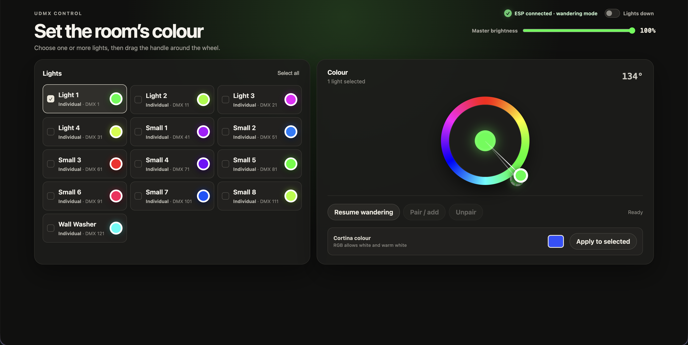
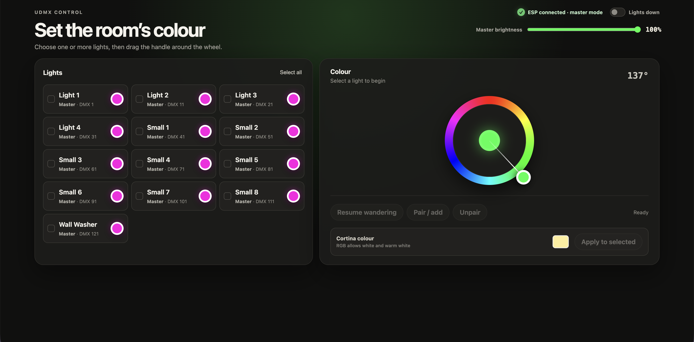
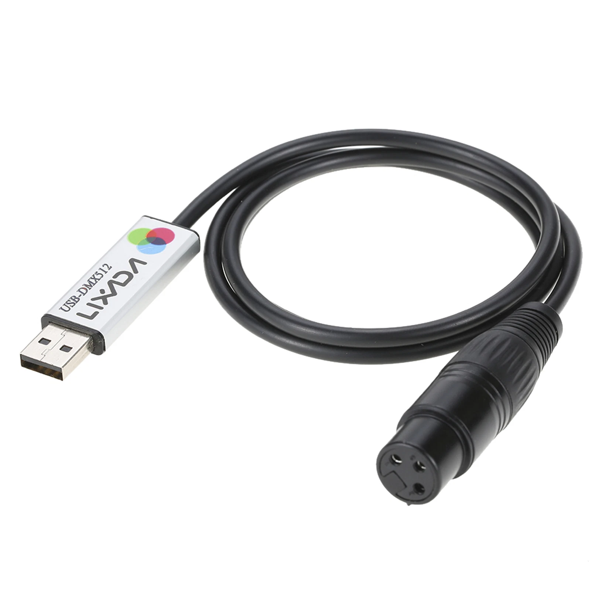
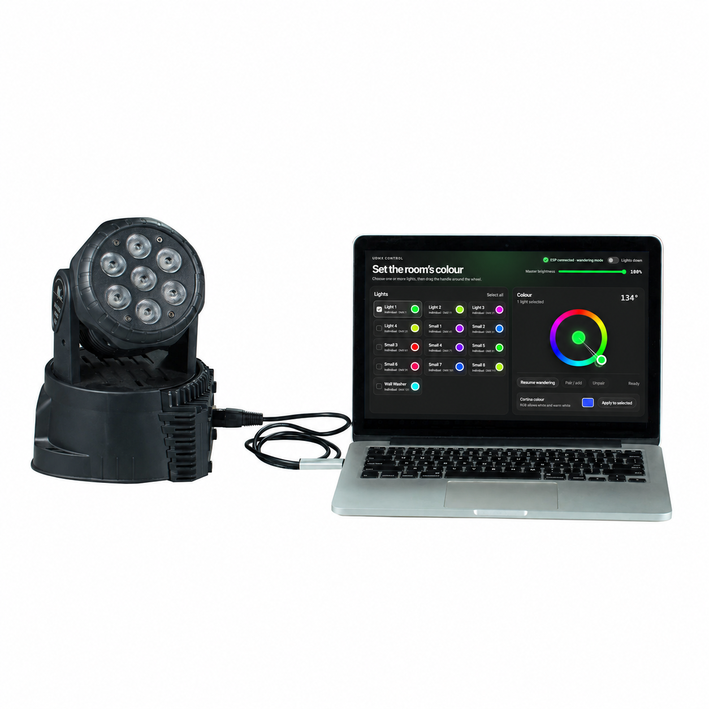

# Lighting controller

Lighting is a small Node.js application that drives room lighting through USB
DMX adapters. It gives configured RGB fixtures continuously wandering colours,
provides a browser control page, coordinates with an optional ESP table-lights
bridge, and raises the room lights automatically while Tanda Forge plays a
cortina.

The controller can send the same DMX universe to one or both supported USB
adapter types:

- **Anyma/uDMX-compatible adapter** using USB control transfers. The usual USB
  identity is `16c0:05dc`.
- **FTDI Open DMX adapter** using a 250000-baud serial DMX stream. Select this by
  serial number where possible, or by device path.

When both adapters are connected, each frame is mirrored to both. If one output
disconnects, the controller continues on the other. Missing DMX outputs are retried every five seconds, including at startup. The
web controls and ESP bridge remain available while DMX is disconnected.

## Lighting behaviour

In normal operation every automatic fixture moves independently between random,
fully saturated hues. Transitions follow the shortest route around the colour
wheel and use the random duration range in `transitionSeconds`.

The optional virtual master periodically gathers the automatic fixtures onto a
shared hue and timing. It completes a random number of shared transitions and
then returns them to independent wandering. Configure this with `masterMode`.
Fixtures held at a static colour from the web page are not changed by normal or
master wandering.

## Music-aware DMX mode

Tanda Forge posts versioned snapshots of its main-output playback to
`POST /api/playback`. Lighting reacts only to normal tango playback on that
output. Headphone previews never drive the lights, and cortinas continue to use
the higher-priority lights-up behavior.

Music mode defaults to disabled when the `music` section is absent or uses
`"enabled": false`; the supplied venue `config.json` enables it. Enabling it
affects automatic DMX fixtures only. Static colours, explicit lights-up,
fixture pairing, master mode, global brightness, and fixture mappings keep
their existing priority. Table lights do not receive audio or brightness data;
in master mode they receive only shared hue targets and transition durations
derived from the same analysed musical events.

### Momentum algorithm

Lighting directly ports the `tango-light-momentum-edges-prototype` analysis and
render formulas. FFmpeg decodes mono 11,025 Hz audio in a worker. Overlapping
1,024-sample FFT windows advance by 256 samples (about 23 ms), producing
track-relative fast and phrase energy, development, three-band attacks, rolling
3.5-second rhythmic momentum, exceptional hits, relative breaks, entrances and
sudden START/STOP edges. Analysis never runs in the 40 FPS DMX loop.

Every automatic DMX fixture has its own hue, target and progress accumulator.
The shared musical step rate advances those independent trajectories; completed
steps choose new random full-wheel destinations. High character raises the
minimum destination distance from 35° to 85°. Ordinary notes do not flash
brightness. Phrase brightness uses the prototype's exact formula and attack /
release smoothing at 97% saturation.

Exceptional hits are accepted only above the track's phrase-energy upper
percentile, with high fast energy, rhythmic momentum and the configured
threshold. They have a four-second cooldown and send every automatic fixture
to its own target at least 100° away using the configured eased kick time.
START/STOP, entrance and break envelopes use the prototype's exact brightness
offsets and colour-speed factors. Seeking suppresses crossed events; pausing
freezes progress.

Manual/static colours, cortina/lights-up, master brightness, fixture channel
mappings and pairing retain priority. Browser indicators consume the final RGB
values produced by the same renderer as DMX.

Whenever master mode is active, every automatic DMX fixture uses one shared
trajectory and the table lights receive that same target hue and remaining
transition duration. This begins immediately even if music analysis is still
pending or music response is disabled. The application sends a new bridge
destination only when the target or a relevant structural state changes, with
a minimum 180 ms command interval; it does not transmit on every 40 FPS DMX
frame. A music pause sends a long-duration hold. Master exit or bridge
disconnection returns the table lights to autonomous wandering; lights-up /
cortina temporarily overrides colour through the existing bridge command.
Table-light brightness is otherwise unchanged.

### Music controls

The web page exposes the prototype controls. Their application defaults are:

- minimum/maximum brightness: 25% / 100%; gamma: 1.05;
- rhythmic momentum influence: 100%; above-average energy influence: 75%;
- movement relaxation: 2500 ms; colour step speed: 220%;
- exceptional kick threshold: 90%; exceptional kick colour time: 650 ms;
- structure effects enabled; AV delay 0 ms.

The corresponding default configuration is:

```json
"music": {
  "enabled": false,
  "minimumBrightnessPercent": 25,
  "maximumBrightnessPercent": 100,
  "gamma": 1.05,
  "rhythmicMomentumInfluencePercent": 100,
  "aboveAverageEnergyInfluencePercent": 75,
  "movementRelaxationMs": 2500,
  "colourStepSpeedPercent": 220,
  "exceptionalKickThresholdPercent": 90,
  "exceptionalKickColourTimeMs": 650,
  "structureEffectsEnabled": true,
  "avDelayMs": 0
}
```

Values explicitly present in `config.json` override these defaults. In the
supplied venue configuration music response is enabled and exceptional kick
colour time is 800 ms; the remaining music values currently match the defaults
above.

FFmpeg must be available on `PATH`. Positive AV delay means later light. Venue
audio, OS, USB, and fixture latency should be measured before relying on a final
offset.

### Individual and master modes

In individual wandering mode, each fixture chooses and follows its own colour
target:



In synchronised master mode, every automatic fixture follows the shared master
target and timing:



The separate **lights up** state temporarily overrides all normal and static
colours. Each fixture fades to its own `lightsUpColour`; **lights down** fades
back into the normal behaviour that has continued underneath. The global
`lightsUp.fadeUpSeconds` and `lightsUp.fadeDownSeconds` settings control these
two fade times.

## Installation and startup

Requirements:

- Node.js 18 or newer.
- A supported USB DMX adapter for DMX fixtures (optional for table-light control).
- A valid `config.json` with non-overlapping fixture addresses.

Install and start:

```sh
npm install
npm start
```

To use a different configuration file:

```sh
node lighting.js path/to/config.json
```

The terminal reports the detected DMX output or outputs, the web address, and
the ESP bridge status. Press Ctrl-C for an orderly shutdown: the application
sends a blackout frame and closes its USB and serial devices.

## Web control page

While Lighting is running, open:

```text
http://localhost:8080
```

The server listens on all network interfaces, so another device on the same
network can use `http://<lighting-computer-address>:8080`. Change `webPort` if
port 8080 is already occupied.

The page provides:

- **Lights up / Lights down** in the top-right corner. This fades the DMX
  fixtures and also sends the state to the ESP bridge when connected.
- **ESP status**, showing whether the table-lights bridge is detected and
  whether it is supplying master or wandering targets.
- **Fixture selection** and **Select all**.
- A **colour wheel**. Moving it holds the selected fixtures at a static hue.
- **Resume wandering**, which removes the static override from the selection.
- **Pair / add**, which makes selected fixtures follow one leader, and
  **Unpair**, which detaches selected members.
- **Cortina colour**, an RGB picker for the selected fixtures' lights-up colour.
  Press **Apply to selected** to apply it immediately and save it into the
  active configuration file. RGB permits pure white, warm white, or a calibrated
  colour for fixtures whose RGB white is unattractive.
- **Master brightness**, which affects every fixture in every mode. Fixtures
  with a brightness/dimmer channel receive this value directly; RGB-only
  fixtures have their RGB values scaled.

When several fixtures are selected, applying a cortina colour sets all of them
to the chosen RGB value. Selecting a single fixture loads its saved cortina
colour into the picker.

## Fixture and channel configuration

DMX addresses and channel offsets are one-based. Define a reusable physical
layout under `fixtureTypes`, then assign that type and a start address to each
entry in `fixtures`.

The supplied configuration contains two example layouts:

| Fixture type | Footprint | Channel mapping used by Lighting |
| --- | ---: | --- |
| `4ch-rgbw` | 4 channels | Red, green, blue; channel 4 (white) held at 0 |
| `8ch-dimmer-rgbw` | 8 channels | Master brightness, red, green, blue; channels 5–8 held at 0 |

These names describe the included fixture profiles, not hard-coded limits. A
fixture type declares its entire `channelCount`, mapped `channels`, and any
`fixedChannels`. Supported mapped roles are `red`, `green`, `blue`, and optional
`brightness`. Unmapped channels are sent as zero. Fixed channels are useful for
mode, strobe, or unused white channels that must stay at a known value.

Example fixtures:

```json
{
  "fixtureTypes": {
    "4ch-rgbw": {
      "channelCount": 4,
      "channels": { "red": 1, "green": 2, "blue": 3 },
      "fixedChannels": { "4": 0 }
    },
    "8ch-dimmer-rgbw": {
      "channelCount": 8,
      "channels": { "brightness": 1, "red": 2, "green": 3, "blue": 4 },
      "fixedChannels": { "5": 0, "6": 0, "7": 0, "8": 0 }
    }
  },
  "fixtures": [
    {
      "id": "floor-1",
      "name": "Floor light",
      "address": 1,
      "type": "4ch-rgbw",
      "lightsUpColour": { "red": 255, "green": 220, "blue": 170 }
    },
    {
      "id": "washer-1",
      "name": "Wall washer",
      "address": 11,
      "type": "8ch-dimmer-rgbw",
      "lightsUpColour": { "red": 255, "green": 255, "blue": 255 }
    }
  ]
}
```

`lightsUpColour` defaults to full RGB white if omitted. Hue plus brightness is
not sufficient for this setting: the normal hue wheel is fully saturated, while
white requires the RGB channels to be mixed together.

Ensure fixture footprints do not overlap and do not extend beyond DMX channel
512. For example, an eight-channel fixture beginning at address 121 occupies
channels 121–128.

## USB DMX adapters

### Anyma/uDMX

Configure the USB vendor and product IDs:

```json
"usb": {
  "vendorId": "0x16c0",
  "productId": "0x05dc"
}
```

Lighting finds this device through USB rather than through a serial device path.
Transfers are retried briefly before the output is treated as disconnected.
Low-speed uDMX hardware can be unreliable behind cascaded bus-powered hubs; use
a direct port or powered hub when possible.

### FTDI Open DMX

Enable the Open DMX output and identify it by serial number (preferred):

```json
"openDmx": {
  "enabled": true,
  "serialNumber": "BG00QGXZ"
}
```

Alternatively specify its operating-system device `path`. A serial number is
more stable because device paths can change after reconnection or reboot.

On macOS, USB identities and serial numbers can be inspected with:

```sh
system_profiler SPUSBDataType
```

Only one application can own an adapter at a time. Stop QLC+, FreeStyler, or any
other DMX program before starting Lighting.

## ESP table-lights bridge

The ESP table-lights bridge sketch is included at
`table-lights/DMX-bridge/tango_light_3_DMX_bridge/tango_light_3_DMX_bridge.ino`. It connects over USB serial and can rebroadcast lighting state to
ESP-NOW-connected table lights.

Lighting scans for the configured USB vendor ID (normally `1a86`) and opens the
bridge at 115200 baud. No machine-specific serial path is built in. If the
operating system does not report a vendor ID, Lighting accepts one unambiguous
USB serial candidate; an explicit `path` is only an optional installation-level
override. Configure or disable the bridge under `externalMaster`:

```json
"externalMaster": {
  "enabled": true,
  "vendorId": "0x1a86",
  "baudRate": 115200,
  "scanSeconds": 5
}
```

The bridge and Lighting exchange newline-delimited messages:

- Lighting sends `1` plus a newline for lights up and `0` plus a newline for
  lights down. The bridge can rebroadcast that state to the table lights.
- Lighting accepts `1`, `up`, or `lightsUp` as an incoming lights-up state and
  `0`, `down`, or `lightsDown` as lights down.
- The bridge can report an ESP-NOW colour target as
  `UDP: hue,durationMilliseconds,brightness,syncMode`.

When `syncMode` is `true`, the bridge has entered master mode: automatic DMX
fixtures move to the received hue over the supplied duration, and Lighting
then supplies the shared, music-responsive master destinations back to the
table-light group with `MASTER` commands. When it is `false`, DMX fixtures and
table lights use their individual/autonomous wandering behaviour. Merely
plugging in the bridge does not force master mode: the indicator remains
**awaiting data** until a valid `UDP:` report arrives.

While connected, the bridge owns the master/wander decision, so Lighting's
timed local virtual-master scheduler is suspended. This authority is not a
permanent master session: each valid `syncMode` report can enter or leave
master mode. If the serial bridge disconnects, external authority is released
and local individual/master scheduling resumes. Static web-page colour
overrides remain in place.

The ESP indicator initially says **awaiting data** because connection alone does
not provide a colour target or master/wander state. It changes after a valid
bridge message arrives.

## Tanda Forge integration

Tanda Forge treats Lighting as an optional local companion service:

- Normal main-output tracks send versioned playback snapshots to
  `POST http://127.0.0.1:8080/api/playback`, including the source path, actual
  media position, duration, playback rate, transport state, session identity,
  and ordered sequence number.
- Playing snapshots arrive approximately every 750 ms and immediately on
  transport changes. Lighting extrapolates the position only while playing.
- Delivery is bounded and times out quickly; an unavailable Lighting process
  never delays audio playback.
- Headphone/cue playback is not published.

- When main-output cortina playback starts, Tanda Forge sends
  `POST http://127.0.0.1:8080/api/lights` with `{ "up": true }`.
- When the cortina pauses or finishes, or normal main playback takes over, it
  sends `{ "up": false }`.
- Lighting fades its DMX fixtures and forwards the same state to the ESP bridge,
  keeping DMX room lights and ESP-NOW table lights together.
- If Lighting is not running, Tanda Forge playback continues normally.

Both applications must be running on the same computer when using the default
localhost address, and Lighting must use port 8080. Restart both applications
after changing their integration code or configuration.

The `/api/lights` endpoint is also available to other local integrations. Send a
JSON body containing a Boolean `up` property.

## Diagnostics and operational help

### Verify fixture addressing

Use diagnostic mode with a configuration containing exactly one fixture:

```sh
node lighting.js --diagnose
```

It holds blackout, isolated red, isolated green, isolated blue, and blackout for
four seconds each while printing the exact transmitted fixture channels. Use it
to confirm the start address, channel order, dimmer channel, and polarity before
enabling animation.

### No DMX output connected

- Confirm that at least one adapter is connected before startup.
- Check the uDMX vendor/product IDs or the FTDI serial number/path.
- Close other DMX software that may own the device.
- Try a direct USB port or powered hub.
- On macOS, inspect the hardware with `system_profiler SPUSBDataType`.

### DMX output stops or flickers

- Avoid an unpowered or cascaded USB hub, especially with uDMX hardware.
- Check USB and DMX cabling and termination.
- Reduce `fps` temporarily to determine whether the adapter or host cannot
  sustain the configured frame rate.
- If two adapters are enabled, read the terminal output to see which transport
  failed; the surviving transport continues. Disconnected outputs are retried
  every five seconds and receive the current lighting state after reconnecting.
- `LIBUSB_ERROR_NO_DEVICE` means the USB adapter became unavailable. The app
  keeps the web controls and ESP bridge running while retrying the adapter.
  The Lights panel displays the current DMX connection status.

### ESP not detected

- Confirm `externalMaster.enabled` is `true`.
- Check that the bridge's USB vendor ID matches `externalMaster.vendorId`.
- If the operating system omits USB identifiers, Lighting automatically uses a
  single unambiguous USB serial device. If several unidentified USB serial
  devices exist, `externalMaster.path` may be configured explicitly for that
  installation; no machine-specific device path is included by default.
- Confirm its firmware uses the configured baud rate and newline termination.
- Wait at least `scanSeconds` after connecting it; Lighting rescans while running.
- Check that no serial monitor has already opened the bridge port.

### Tanda Forge does not raise the lights

- Confirm the Lighting web page works at `http://127.0.0.1:8080` on the same
  computer as Tanda Forge.
- Test the web-page lights-up switch first; this separates Lighting/DMX/ESP
  problems from the Tanda Forge notification.
- Fully restart both applications after updating them.
- Ensure Tanda Forge is playing the cortina on its **main output**, not merely a
  headphone preview.
- Inspect the Tanda Forge developer console for
  `Could not notify the Lighting controller`.

### Web page is unavailable

- Confirm the terminal printed `Lighting controls: http://localhost:<port>`.
- Check `webPort` and use that same port in the browser.
- If controlling from another device, use the Lighting computer's LAN address
  rather than `localhost`, and allow the port through its firewall.

### Configuration errors

Lighting validates the configuration at startup and prints an actionable error
for invalid ranges, unknown fixture types, duplicated IDs, overlapping DMX
addresses, or fixtures extending past channel 512. Correct the reported entry
and restart the controller.

Run the JavaScript syntax checks without opening hardware:

```sh
npm run check
```

## Example hardware

The following third-party product photographs are included only as visual
examples. They are not project-owned images, endorsements, or purchasing
recommendations. Check that any hardware you use meets the USB and DMX
requirements described above.

### USB DMX adapter

A typical USB-to-DMX adapter with a three-pin XLR DMX connector:



### Connection to a DMX light

An example of the kind of computer-to-fixture connection used in a small DMX
lighting setup:



### Table lights colour control

With the updated bridge firmware, a **Table lights** panel appears automatically
when the bridge reports its capabilities. Select its card (alone or alongside DMX
fixtures) and use the colour wheel to hold the whole wireless group at a hue.
**Resume wandering** restores the bridge's automatic sync/wander cycle. The table
lights' firmware does not need changing.

The bridge sends the held hue every 50 ms with a fresh 250 ms transition. It keeps
its normal automatic sequence running separately for unselected DMX fixtures.
The panel shows the requested group colour, not measured feedback from each light;
individual wandering colours cannot be displayed. Master brightness and custom
cortina RGB settings remain DMX-only. Global lights up/down still controls
the table lights' existing white override.

Select **Table lights** together with one or more DMX fixtures and click
**Pair / add** to make the wireless group follow a DMX leader. Existing DMX pairs
can be extended in the same way. Selecting either the tables or a DMX member then
controls the whole pair: the colour wheel holds their colour and **Resume
wandering** makes them follow the leader's automatic transitions. The app sends
the leader's current hue to the bridge at most every 50 ms, so the table lights
follow with a small smoothing delay rather than exact frame synchronisation.

**Unpair** on Table lights restores the bridge's automatic behaviour. If you
remove a DMX leader from a larger pair, the tables follow the remaining DMX
leader; removing the last DMX member releases the tables. Pairing is kept during
a bridge reconnect while the app runs, but is not saved across app restarts.
An orderly app shutdown releases paired tables back to automatic mode. This uses
the existing colour-control bridge firmware; no further upload is needed.

USB commands are newline-delimited: `STATIC <hue>` (0–359.999),
`MASTER <target-hue> <duration-ms>`, `WANDER`, `BRIDGE?`, and the existing
`1`/`0` lights-up/down commands. `MASTER` retains the original ESP-NOW payload
and lets Lighting supply a smooth music trajectory; `WANDER` releases that
override and restores autonomous sync-mode timing. The bridge responds
with `TABLE: {"static":true,"hue":120}` status reports. Existing `UDP:` reports
continue to describe the automatic sequence. Old bridge firmware remains usable
for automatic lighting but does not expose the new panel. A bridge reboot clears
the static override; reconnecting queries its current state.

To build in Arduino IDE, put the sketch in a folder named
`tango_light_3_DMX_bridge`, select your ESP8266 board/settings, and export the
compiled binary. Only upload to the bridge, not the table lights.

Run `node --test tests/bridge.test.mjs` to check serial capability detection,
static/wander commands, invalid selection handling, and disconnection without
opening real hardware.
